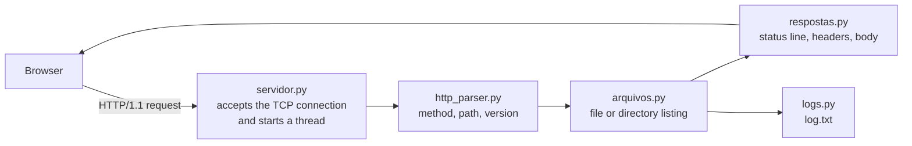

# HTTP/1.1 Server from Scratch

🇧🇷 [Leia em português](README.pt-BR.md)


An HTTP/1.1 web server written in pure Python on top of raw TCP sockets — no frameworks and no libraries that abstract the protocol. Built for the Computer Networks course (UAB00078) of the Computer Engineering degree at UFRPE / UABJ, taught by Prof. Ygor Amaral Barbosa Leite de Sena.

## Features

- Hand-written HTTP/1.1 request parser (method, path, version, headers)
- Persistent connections (Keep-Alive) and one thread per client
- Static files streamed in 8 KB chunks, so large files never load fully into memory
- MIME type detection by extension
- Apache-style directory listing, serving `index.html` when present
- Status codes 200, 400, 403, 404 and 505, each with a custom error page
- Path traversal protection: requests such as `/../../etc/passwd` get `403`
- Access log written to `log.txt`

## How it works



| File | Responsibility |
| :--- | :--- |
| `servidor.py` | Entry point: socket, accept loop and threading |
| `http_parser.py` | Parses the HTTP/1.1 request |
| `arquivos.py` | Serves files and builds directory listings |
| `respostas.py` | Builds and sends HTTP responses |
| `erros.py` | Custom error pages |
| `logs.py` | Access log |
| `test_arquivos.py` | Tests (`unittest`) |

## Running

Requires Python 3.10+. No external dependencies.

```bash
python servidor.py
# Servidor HTTP rodando em: http://localhost:8080
```

Then open:

- <http://localhost:8080/> — serves `index.html`
- <http://localhost:8080/pasta_teste/> — generated directory listing
- <http://localhost:8080/missing.html> — custom 404 page

Log lines look like this:

```
[2026-05-11 14:30:22] 127.0.0.1 GET /index.html 200
```

## Tests

```bash
python -m unittest -v
```

## Development

Each feature was tracked as a GitHub issue, built on its own branch and merged through a pull request ([history](https://github.com/Guilherme-L-C/Server_ComputerNetworking/pulls?q=is%3Apr)).

## License

[MIT](LICENSE) © Guilherme Leite Cavalcanti
